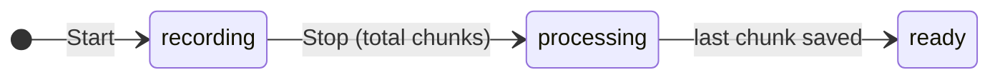
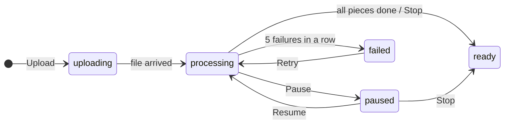

# Architecture

Summarise turns a lecture into a transcript in one of two ways:

- **Live recording.** The browser cuts the audio into ~30 second chunks, and
  the service transcribes each one as it arrives.
- **Uploaded file.** The file goes straight to object storage, and a
  background worker transcribes it piece by piece.

Both end in the same place: a note in Postgres with one transcript segment per
~30 seconds of audio.

The system diagram is in [`system-design.excalidraw`](system-design.excalidraw).
To edit it, open it at excalidraw.com (Open, then pick the file).

## Parts

A pnpm monorepo. Runnable code lives in `apps/`, shared code in `library/`.
Apps never import each other; they share code only through `library/`.

| Package                    | What it does                                                                                        |
| -------------------------- | --------------------------------------------------------------------------------------------------- |
| `apps/web`                 | React + TanStack Query. The recorder, the chunk outbox, uploads, and every screen.                  |
| `apps/service`             | Express API: auth, notes, live chunks (transcribed inline), uploads and their controls.             |
| `apps/worker`              | Transcribes uploaded files: takes jobs from Redis, decodes with ffmpeg, sends pieces to Groq.       |
| `library/storage`          | Drizzle tables, migrations and repositories for `users`, `notes`, `transcript_segments`.            |
| `library/contract`         | Zod schemas for every HTTP request, response and error code.                                        |
| `library/queue`            | The Redis client and the upload queue: push, take, lock, renew, put back, finish.                   |
| `library/speech-to-text`   | The Groq client (`whisper-large-v3-turbo`) and its errors: retryable, rejected for good, bad setup. |
| `library/blob`             | Object storage over S3 (Neon Object Storage): presigned PUT and GET, head, delete.                  |
| `library/config`, `logger` | Validated env vars (a missing one fails at start) and one pino logger.                              |

Each shape has one home: HTTP shapes in `contract`, tables in `storage`, job
payloads in `queue`. Change a field in `contract` and both `web` and `service`
fail typecheck until fixed.

```
web ──HTTP──▶ service ──LPUSH──▶ Redis ──BLMOVE──▶ worker
 │               │                                  │   │
 │               ├──────────▶ Postgres ◀────────────┘   │
 │               └──────▶ Groq ◀────────────────────────┘
 └──PUT file──▶ Object storage ◀──GET (stream)──────────┘
```

## Flow 1: live recording

The browser cuts the audio and never loses a chunk. The service stays simple:
one request in, one segment out, no queue.

1. **Record and cut** (`chunk.recorder.ts`). MediaRecorder captures the mic at
   32 kbps. After 25 s it cuts at the first 300 ms pause below −45 dB, or at
   35 s if nobody pauses, so no word is split. Each chunk is a standalone
   audio file.
2. **Save it first** (`recording.store.ts`). The chunk goes into IndexedDB
   (Dexie) with the next `seq`, in the same write that bumps the counter, so a
   `seq` is never reused even if the tab dies.
3. **Send in order** (`upload.queue.ts`). One chunk at a time, oldest first, as
   `POST /notes/:id/chunks`. A failure retries after the service's
   `Retry-After`, or 2 s, 4 s, 8 s… up to 30 s. A 401 refreshes the session;
   any other 4xx drops the chunk.
4. **Transcribe inline** (`recording.service.ts`). The service sends the audio
   to Groq with the last 200 characters of the previous segment as a prompt.
   A busy Groq becomes a 503, so the browser keeps the chunk and retries.
5. **Save the segment.** One row per chunk, unique on `(note_id, seq)`, so a
   retried chunk overwrites its own row. Audio Groq rejects for good is saved
   as a gap. Only then does the browser delete its copy.
6. **Stop.** Stop sends the total chunk count; the note goes to `processing`
   and becomes `ready` in the statement that sees the last segment arrive.

Why:

- **No audio stored** unless the note asks for it ("keep audio").
- **No queue for live chunks.** A ~30 s chunk transcribes in a second or two,
  so the lag stays around 35–45 s with nothing extra to run.
- **The browser is the source of truth until saved.** Closing the laptop or
  losing Wi-Fi loses nothing; the outbox sends it later.
- **Every write is safe to repeat.**

## Flow 2: uploading a recording

A file can be 500 MB and 4 hours long: too big for one request and too slow to
transcribe inline. So the file skips the service, and a worker transcribes it
in the background.

1. **Make the note** (`POST /notes/uploads`). Inserts the note as `uploading`
   and returns a presigned PUT URL for `uploads/<noteId>/source`, signed for
   this file's type and size, valid 15 minutes. No Redis yet.
2. **Send the file directly.** The browser PUTs the whole file to object
   storage in one request. Progress comes from axios `onUploadProgress`, so
   only that tab knows it. The file never touches the service or the worker's
   disk.
3. **Queue it** (`POST /notes/:id/upload/complete`). The service checks the
   file is there (HEAD), moves the note to `processing` and LPUSHes
   `{"noteId": …}` onto `uploads:pending`. If Redis is down, the note goes
   back to `uploading` and the browser retries.
4. **Take and lock** (`upload.worker.ts`). A worker loop takes the job and
   locks the note in Redis, so no other loop or worker runs it at once.
5. **Measure, decode, cut** (`upload.transcriber.ts`). ffprobe reads the length
   (for the "25%" progress). ffmpeg streams the file through a presigned GET
   and decodes it to 16 kHz mono. The same 25–35 s cut-at-a-pause rule as the
   browser makes ~30 s pieces. Only one piece (~1 MB) is in memory at a time;
   the whole file is never loaded or written to disk.
6. **Transcribe piece by piece.** The worker calls Groq itself; pieces never
   pass through the service. One piece at a time, each with the previous
   piece's last 200 characters as a prompt. Before each piece, and again
   before saving it, the worker checks the note is still `processing`, so
   Pause, Stop and Delete take effect within one piece. Saved pieces are
   skipped, so a retried job carries on where it stopped.
7. **Finish.** The note becomes `ready` with its real length and piece count,
   and the file is deleted.

Controls while it runs:

- **Pause** sets `paused`. The worker notices before the next piece, drops the
  job and keeps what's saved.
- **Resume** (or **Retry** after a failure) sets `processing` and pushes a new
  job, which skips the saved pieces.
- **Stop** makes the note `ready` with the segments so far, sets its length
  from them, and deletes the file.
- **Cancel** deletes the note and its file. The worker sees the note gone and
  stops quietly.

Limits:

- 500 MB per file; audio past 4 hours isn't transcribed.
- Two jobs at a time per worker (`WORKER_CONCURRENCY`, default 2).
- Uploads never completed are deleted after 24 hours.

## Groq usage and speed

- **Calls per upload.** One call per ~30 s piece: about 120 calls for a 1-hour
  file. Groq bills by audio length, not by call count, so this costs the same
  as fewer, bigger calls.
- **Speed today.** A 1-hour upload takes about 6–7 minutes (~3 s per piece),
  because pieces are sent one after another.
- **Rate limits.** The free tier limits requests per minute and audio per
  hour and per day. At 20 requests a minute, 120 calls take about 6 minutes
  on their own, so the tier can be the cap rather than the code. Check the
  limits page in the Groq console for the account's real numbers.

## How Redis is used

Redis does one job: it's the upload queue between the service and the worker.
A plain Redis list with a lock per note, not BullMQ. Live recording doesn't
touch it, auth doesn't use it (sessions are JWT cookies), and nothing is
cached in it. The app never reads it; the UI reads status from Postgres.

| Key                        | Type              | Holds                                                                                                    |
| -------------------------- | ----------------- | -------------------------------------------------------------------------------------------------------- |
| `uploads:pending`          | list              | Jobs waiting, as `{"noteId": …}`. New jobs go in at the head; workers take from the tail (oldest first). |
| `uploads:active`           | list              | Jobs a worker has taken and not finished. If a worker crashes, its job is still here.                    |
| `upload:lock:<noteId>`     | string, 60 s TTL  | `<workerId>:<loop>` running the note. Renewed every 20 s; expires if renewals stop.                      |
| `upload:failures:<noteId>` | counter, 24 h TTL | Failed runs in a row. Cleared when a piece is saved. At 5 the note is marked `failed`.                   |

A job's life:

| Command         | Step                                                                                                                      |
| --------------- | ------------------------------------------------------------------------------------------------------------------------- |
| `LPUSH`         | **Queued** when the upload completes, or on Resume and Retry.                                                             |
| `BLMOVE`        | **Taken.** A loop waits up to 5 s and moves the job from pending to active in one step. Each loop has its own connection. |
| `SET NX PX`     | **Locked** for 60 s. If another copy already holds the lock, this copy is dropped as a duplicate.                         |
| `EVAL` renew    | **Kept alive** every 20 s, only if the lock is still this loop's. A lost lock tells the job to stop.                      |
| `LREM` + `DEL`  | **Finished** on success or a final failure: removed from active, lock released, failure count cleared.                    |
| `EVAL` put back | **Handed back** when the worker pauses itself: moved to the front of pending, lock released.                              |
| (expire)        | **Retried.** After a failure or a lost lock the job is left; recovery (every 60 s) requeues active jobs with no lock.     |

## Note statuses

The status lives on the note in Postgres. The app polls it every 5 s, and the
worker checks it before every piece.





Any note can be deleted at any time (Cancel); its segments go with it.

## When things go wrong

| Situation                            | What happens                                                                                   |
| ------------------------------------ | ---------------------------------------------------------------------------------------------- |
| Wi-Fi drops mid-recording            | Chunks wait in IndexedDB and send in order when it's back.                                     |
| Groq busy during live recording      | 503 with `Retry-After`; the browser keeps the chunk and tries again.                           |
| Groq busy during an upload           | The worker retries each piece (5, 10, 20, 40 s), then the run fails and is retried later.      |
| Groq rejects one piece's audio       | Saved as a gap; transcription carries on.                                                      |
| Bad Groq key or model                | The worker hands every job back, checks the key every 5 minutes, and carries on when it works. |
| Worker crashes or the machine sleeps | The lock expires, recovery requeues the job, the next run skips saved pieces.                  |
| File with no readable audio          | The note is marked `failed` straight away.                                                     |
| Note in `processing` with no job     | The sweeper requeues it within 5 minutes.                                                      |
| Deploy or Ctrl-C                     | The worker stops taking jobs, waits up to 20 s, then exits; the rest carries on after restart. |

## Where to look

Live recording:

- `apps/web/src/lib/recording/` (`chunk.recorder.ts`, `recording.store.ts`, `upload.queue.ts`)
- `apps/web/src/components/recorder/RecorderProvider.tsx`
- `apps/service/src/modules/recording/recording.service.ts`
- `apps/service/src/modules/note/note.service.ts` (stop)

Upload:

- `apps/web/src/components/upload/UploadsProvider.tsx`
- `apps/service/src/modules/upload/upload.service.ts`
- `library/queue/src/upload.queue.ts`
- `apps/worker/src/upload/` (`upload.worker.ts`, `upload.transcriber.ts`, `upload.sweeper.ts`)
- `apps/worker/src/audio/` (ffprobe, ffmpeg decoder, cut planner)

## Module structure

A module (e.g. `note`, `upload`) has the same name everywhere:

```
apps/service/src/modules/note/
  note.routes.ts         Express router: paths + validation
  note.controller.ts     reads req, calls service, sends res
  note.service.ts        business logic

apps/web/src/
  pages/note/NotePage.tsx
  hooks/…
  api/note/note.api.ts   axios calls

library/contract/src/note/note.schema.ts
library/storage/src/note/note.table.ts, note.repository.ts
```

Apps import libraries from the package root:

```ts
import { NoteSchema, type PublicNote } from '@summarise/contract';
```

## Naming conventions

| Thing                 | Convention                                 | Example                                      |
| --------------------- | ------------------------------------------ | -------------------------------------------- |
| Folders               | kebab-case, singular                       | `note/`, `transcript-segment/`               |
| Backend/library files | `<module>.<role>.ts`                       | `note.service.ts`                            |
| React components      | `PascalCase.tsx`                           | `UploadRow.tsx`                              |
| React hooks           | `useXyz.ts`                                | `useUploadControls.ts`                       |
| Package names         | `@summarise/<name>`                        | `@summarise/storage`                         |
| Types                 | PascalCase                                 | `PublicNote`                                 |
| Zod schemas           | PascalCase ending in `Schema`              | `NoteSchema`                                 |
| Functions, variables  | camelCase                                  | `createNoteService`                          |
| Constants, env keys   | SCREAMING_SNAKE_CASE                       | `DATABASE_URL`                               |
| Tables                | TS camelCase plural, SQL snake_case plural | `transcriptSegments` / `transcript_segments` |

## Rules

- Never edit `package.json` or `pnpm-lock.yaml` by hand. Use pnpm commands.
- Never write migration files by hand. Generate them with
  `pnpm --filter @summarise/storage generate`.
